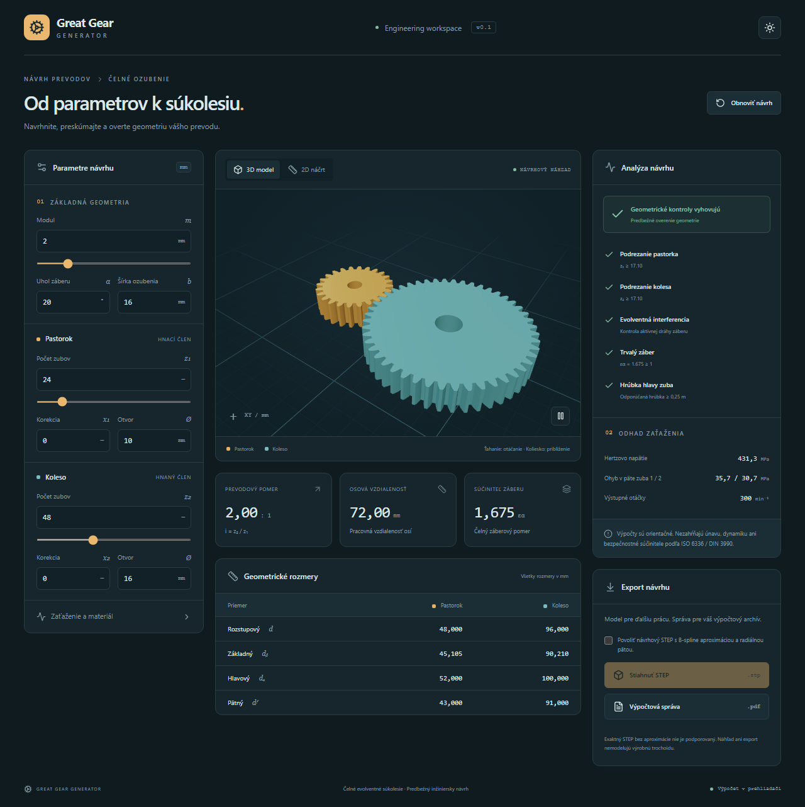
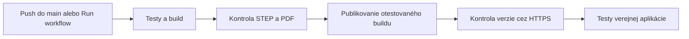
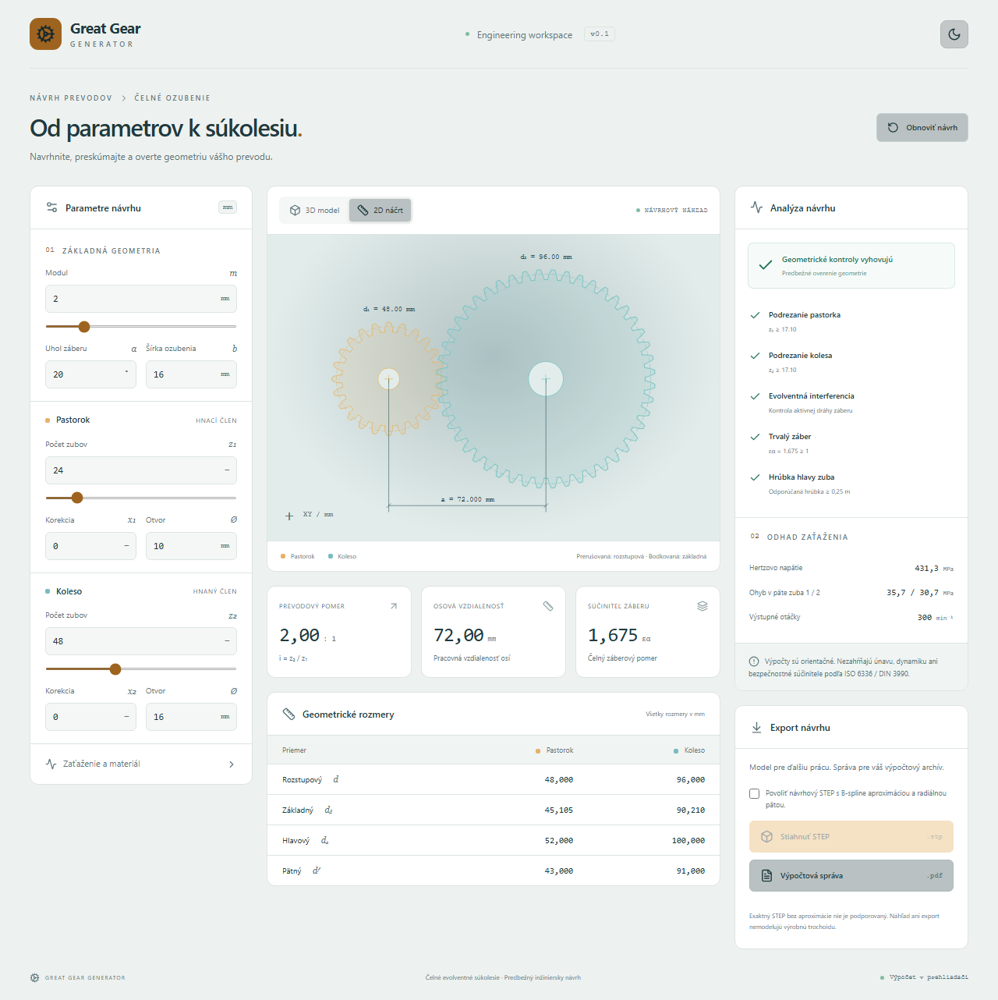
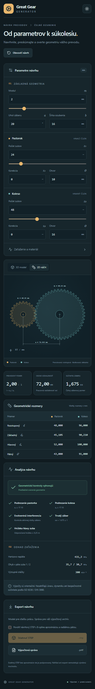

<div align="center">

# ⚙️ Great Gear Generator

**Od parametrov k súkolesiu.**

Návrh, predbežná analýza a CAD export čelných evolventných súkolesí priamo v prehliadači.

[](https://greatgeargenerator-bucala.surge.sh)
[](https://github.com/bucala/GreatGearGenerator/actions/workflows/deploy.yml)

[](https://github.com/bucala/GreatGearGenerator/actions/workflows/ci.yml)
[](https://github.com/bucala/GreatGearGenerator/actions/workflows/deploy.yml)
[](LICENSE)

[Spustenie](#spustenie) · [Deployment](#deployment) · [Ukážky](#ukazky) · [Funkcie](#funkcie) · [Overenie](#overenie) · [Výpočtový model](docs/ENGINEERING.md)

</div>

[](https://greatgeargenerator-bucala.surge.sh)

> **Návrhový nástroj:** výsledok „vyhovuje“ označuje predbežné geometrické kontroly.
> STEP používa výslovne povolenú B-spline aproximáciu. Nejde o certifikované výrobné
> dáta ani pevnostné overenie podľa ISO 6336 / DIN 3990. [Rozsah a rovnice →](docs/ENGINEERING.md)

## Spustenie

Najrýchlejšie: **[otvoriť online aplikáciu](https://greatgeargenerator-bucala.surge.sh)**.
Výpočty, 2D/3D, PDF a návrhový STEP fungujú bez samostatného servera.

<details open>
<summary><strong>💻 Lokálne spustenie — iba Node.js 24 a npm</strong></summary>

```sh
cd frontend
npm ci
npm run dev
```

Otvorte adresu vypísanú Vite (zvyčajne http://127.0.0.1:5173).
Pre náhľad produkčného buildu použite `npm run build` a `npm run preview`.

</details>

<details>
<summary><strong>🐍 Voliteľný Python backend a Windows launcher</strong></summary>

Potrebujete Python 3.13, uv a Node.js 24.

```powershell
.\scripts\start.ps1
```

Aplikácia sa otvorí na http://127.0.0.1:8000. Skript nainštaluje závislosti,
zostaví frontend a spustí FastAPI. Ukončenie: Ctrl+C.
Predvolený frontend aj tu počíta v prehliadači. Pre serverové výpočty zostavte
frontend s `VITE_RUNTIME=api`; [postup je v dokumentácii](docs/DEPLOYMENT.md).

Ručné spustenie servera z koreňa projektu:

```sh
uv sync --frozen
uv run --frozen python -m uvicorn backend.app.main:app --host 127.0.0.1 --port 8000
```

OpenAPI: http://127.0.0.1:8000/docs. Pri vývoji Vite proxuje `/api` na port 8000.

</details>

## Deployment

**Automaticky po pushi alebo zlúčení do `main`, až po úspešných kontrolách.** Vetvy s rozpracovanými zmenami a pull requesty sa nepublikujú. Manuálny deployment zostáva dostupný:

1. Otvorte **[Deploy to Surge](https://github.com/bucala/GreatGearGenerator/actions/workflows/deploy.yml)**.
2. Kliknite na **Run workflow**, vyberte **main** a spustite ho.
3. Výsledok aj odkaz na aplikáciu nájdete v súhrne behu.



<details>
<summary><strong>⌨️ Spustiť deployment z terminálu</strong></summary>

S prihláseným GitHub CLI:

```sh
gh workflow run deploy.yml --repo bucala/GreatGearGenerator --ref main
gh run list --repo bucala/GreatGearGenerator --workflow deploy.yml --limit 5
```

Alebo z adresára `frontend`: `npm run deploy:request`.
Nie je potrebné lokálne zostavenie ani lokálny Surge token.

</details>

<details>
<summary><strong>🔐 Čo deployment automaticky zabezpečí</strong></summary>

- Spustí Python, TypeScript a prehliadačové testy vrátane kontroly skutočných exportov.
- Publikuje presne ten build, ktorý prešiel kontrolami; v deploy kroku ho nezostavuje znova.
- Používa secret `SURGE_TOKEN` v GitHub prostredí `surge-production`.
- Token je obmedzený na `greatgeargenerator-bucala.surge.sh`.
- Nasadenia serializuje, aby sa neprepisovali súbežne; podporuje iba vetvu `main`.
- Overí publikovaný commit cez `build-info.json`, potom otestuje verejnú aplikáciu.
- Uloží snímky, exporty a záznamy zlyhaní ako artefakty behu.

Ak zlyhá kontrola po publikovaní, nová verzia už môže byť online. Postup obnovy,
rotácia tokenu a jednorazové nastavenie sú v [návode na deployment](docs/DEPLOYMENT.md).

GitHub riadi CI/deployment. [GitLab](https://gitlab.com/bucala/GreatGearGenerator)
je synchronizovaná kópia zdrojov; README odkazuje na rovnaký deployment.

</details>

<a name="ukazky"></a>

## Ukážky

Kliknutie na hlavný náhľad otvorí aplikáciu. Ďalšie pohľady rozbalíte nižšie.

<details>
<summary><strong>☀️ Svetlá téma a 2D náčrt s kótami</strong></summary>

[](docs/assets/workbench-light.png)

</details>

<details>
<summary><strong>📱 Mobilné rozloženie</strong></summary>



</details>

## Funkcie

**Reverzný návrh zo skenu:** z počtu zubov a nameraných priemerov nájde prípustné kandidáty modulu, uhla a korekcie vrátane tolerancie a porovnania odchýlok. Podporuje samostatné koleso aj pár so známou nominálnou osovou vzdialenosťou a prenos kandidáta do 2D/3D návrhu. Merania nemusia určovať jediné riešenie. [Postup, rovnice a obmedzenia →](docs/REVERSE_ENGINEERING.md)

**Model päty a detail zuba:** prepínač bez zaoblenia / s navrhovaným kruhovým zaoblením mení 2D, 3D aj STEP. Zväčšený detail zuba a medzery pre obe kolesá obsahuje analytické kóty priemerov, rozstupu, hrúbky, výšok a polomeru päty; možno ho stiahnuť ako SVG. Samostatne sa dá zapnúť aj hlava zuba a priestorové zaoblenie hrán po šírke (to zapne aj oba rovinné prechody). Navrhované polomery nie sú výrobná trochoida.

| Návrh | Výsledok |
| --- | --- |
| Modul, zuby, uhol, korekcie, šírka, otvory | Analytické rozmery oboch kolies a pracovná osová vzdialenosť |
| Otáčateľný 3D model a animácia | Prehľad súkolesia s priblížením a otáčaním |
| 2D náčrt | Kružnice, hlavné rozmery a osová vzdialenosť |
| Geometrická analýza | Riziko podrezania, evolventná interferencia, záber a hrúbka hlavy |
| Zaťaženie a materiál | Hertzov odhad; Lewisov odhad pre nekorigované 20° ozubenie |
| PDF správa | Parametre, tabuľky, výsledky a obmedzenia výpočtu |
| Návrhový STEP | Dve telesá s otvormi; až po povolení aproximácie |

<details>
<summary><strong>📐 Presnosť CAD a hranice výpočtu</strong></summary>

Evolventné rovnice sa vyhodnocujú analyticky. Náhľad je vzorkovaný; STEP používa
B-spline aproximáciu 65 analytických bodov na bok, kružnicové oblúky a radiálnu
pätu alebo voliteľný dotyčnicový kruhový prechod. Exaktný STEP bez spline aproximácie nie je implementovaný. Nie je
certifikovaná globálna hranica geometrickej odchýlky.

Výrobná trochoida, podrezaná päta a vôľa nie sú modelované.
Zaťažovacie odhady nezahŕňajú únavu, dynamiku ani bezpečnostné súčinitele.
Neplatný návrh blokuje STEP export. PDF zostáva dostupné aj pre nevyhovujúci návrh.

[Podrobné rovnice a zdroje →](docs/ENGINEERING.md)

</details>

## Overenie

<details>
<summary><strong>🧪 Spustiť kompletné kontroly lokálne</strong></summary>

Z koreňa projektu:

```sh
uv sync --frozen --group dev
uv run pytest -q
uv run ruff check backend scripts
uv run ruff format --check backend scripts
cd frontend
npm ci
npm test
npm run build
npx playwright install chromium
npm run test:e2e
cd ..
uv run python scripts/verify_browser_exports.py
```

Testy pokrývajú referenčné matematické prípady, validáciu, 3D/2D, témy,
responzivitu, chybové stavy, sťahovanie PDF a spätné načítanie STEP cez CadQuery.
Snímky a výstupy sú v ignorovanom adresári `output/`.

</details>

<details>
<summary><strong>🔌 API a technológie</strong></summary>

Frontend: React, TypeScript, Tailwind CSS, React Three Fiber, Three.js, jsPDF,
Replicad a OpenCascade WebAssembly. Voliteľný backend: FastAPI, CadQuery a ReportLab.
Rozhranie je po slovensky; PDF report po anglicky.

`POST /api/analyze`, `POST /api/generate-report`, `POST /api/generate-step`:

```json
{
  "module": 2, "teeth1": 24, "teeth2": 48, "pressure_angle": 20,
  "profile1": 0, "profile2": 0, "width": 16, "bore1": 10, "bore2": 16,
  "torque": 10, "rpm": 600, "elastic_modulus": 210000, "poisson_ratio": 0.3
}
```

Jednotky: mm, N·m, ot/min, MPa. Serverový STEP navyše vyžaduje
`allow_approximation: true`. `GET /api/health` uvádza `exact_step: false`.
API je určené na lokálne použitie a nemá autentifikáciu.

Závislosti uzamykajú `uv.lock` a `frontend/package-lock.json`.

</details>

<details>
<summary><strong>🗂️ Mapa projektu</strong></summary>

```text
frontend/src/       rozhranie, matematika, CAD worker a PDF export
frontend/e2e/       testy celej aplikácie v prehliadači
backend/app/        voliteľné Python API a CAD jadro
backend/tests/      matematické a API testy
scripts/            spustenie, overenie exportov a verzia nasadenia
docs/               deployment, výpočtový model a náhľady
.github/workflows/  automatické kontroly a deployment na vyžiadanie
```

</details>

---

[Online aplikácia](https://greatgeargenerator-bucala.surge.sh) · [Spustiť deployment](https://github.com/bucala/GreatGearGenerator/actions/workflows/deploy.yml) · [GitHub](https://github.com/bucala/GreatGearGenerator) · [GitLab](https://gitlab.com/bucala/GreatGearGenerator) · [MIT licencia](LICENSE)
